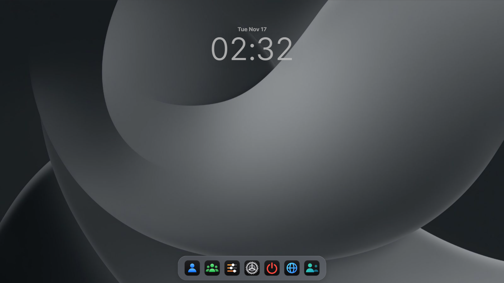
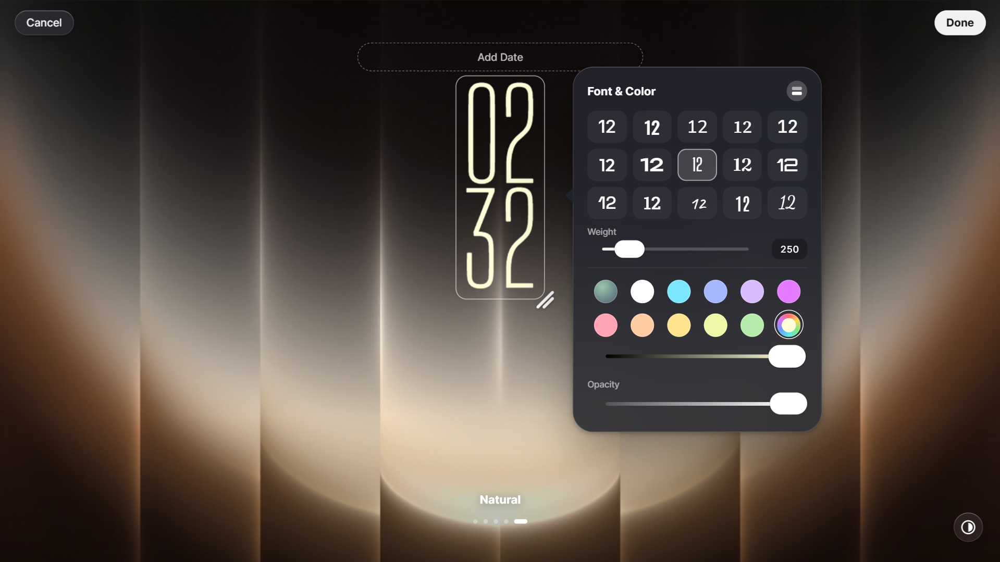

# iOSbounce

  
  
  

## Download

**[Download the latest build](../../releases/latest/download/iosbounce.zip)** compiled from the newest commit.

### Install

#### Auto (Recommended):
1. In the client, just paste `.client theme set iosbounce` in, then you're all set, you can also install it from the liquidlauncher's theme section itself.

#### Manual:
1. In the client, run `.client theme browse` to open the themes folder (or in the C:\Users\YOURUSER\AppData\Roaming\CCBlueX\LiquidLauncher\data\gameDir\nextgen\LiquidBounce\marketplace\items\721\4980\paste it here (the two last folder's numbers might be different, which is fine, you need to have at least one theme installed from the liquidlauncher itself, delete the dist of it, then paste the iosbounce folder in.)
2. Apply it with `.client theme set iosbounce`.

Feel free to point out bugs, At @YuriErotica Telegram if you needed contact.

Made with extra 💜 All Lovleans
