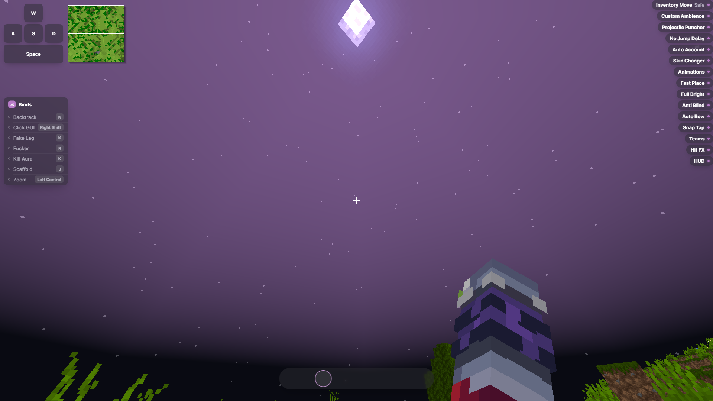

# iOSbounce

  
  
  

## Download

**[Download the latest build](../../releases/latest/download/iosbounce.zip)**: compiled from the newest commit.

### Install

1. In the client, run `.client theme browse` to open the themes folder (or in the C:\Users\YOURUSER\AppData\Roaming\CCBlueX\LiquidLauncher\data\gameDir\nextgen\LiquidBounce\marketplace\items\721\4980\paste it here, you need to have at least one theme installed from the liquidlauncher itself)
2. Unzip the download there.
3. Apply it with `.client theme set iosbounce`.

Feel free to point out bugs, At @YuriErotica Telegram if you needed contact.

Made with extra 💜 All Lovleans
